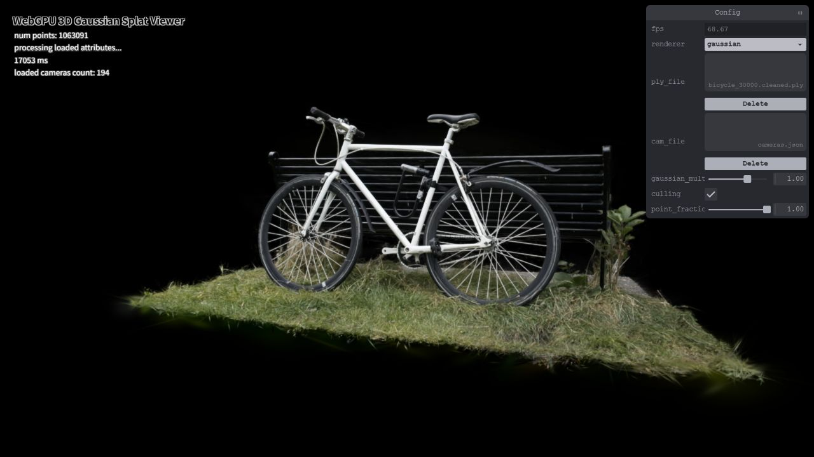

# WebGPU 3D Gaussian Splat Viewer

**University of Pennsylvania, CIS 565: GPU Programming and Architecture, Project 5**

- Author: TODO
- Tested on: Google Chrome 155.0.8059.86, Windows build 26200
- Hardware: NVIDIA GeForce RTX 3060 Laptop GPU, Intel Core i7-12700H, 32 GB RAM
- Runtime: 1280 x 720 WebGPU canvas



## Overview

This project implements a real-time 3D Gaussian Splatting renderer in WebGPU and
WGSL. Gaussian PLY files are loaded into GPU storage buffers, preprocessed into
projected 2D splats, sorted back-to-front with a GPU radix sort, and rendered as
instanced screen-space quads with spherical-harmonics color and alpha blending.

The included Bicycle scene contains 1,063,091 Gaussians and 194 camera presets.

## Implemented Features

- Point-cloud baseline with camera view/projection transforms.
- 3D covariance reconstruction from log-scale values and normalized quaternions.
- Perspective projection to 2D covariance with a 0.3 diagonal low-pass term.
- Conic extraction, three-sigma radius, and NDC quad extents.
- Frustum culling with a 1.2x NDC guard region.
- GPU atomic instance counting and indirect quad drawing.
- Degree-3 spherical-harmonics view-dependent color.
- Far-to-near radix sorting using a float-bit depth key.
- Conic-based elliptical falloff and source-over alpha blending.
- Interactive Gaussian scale, culling, and Gaussian sampling controls.

## Running

```powershell
npm install
npm run dev
```

Open the local Vite URL, then load a Gaussian `.ply` file and its
`cameras.json` file from the GUI. A WebGPU-capable browser and a high-performance
GPU adapter are required.

The recommended test scene is `bicycle_30000.cleaned.ply`.

### Controls

- Left drag: rotate the camera.
- Right drag: pan.
- Mouse wheel: move forward or backward.
- Number keys `0`-`9`: select camera presets.
- `gaussian_multiplier`: scale all Gaussian ellipsoids.
- `culling`: toggle view-frustum culling for performance experiments.
- `point_fraction`: hash-sample a subset of Gaussians for scaling experiments.

Preprocessor workgroup size can be selected at page load with the `wg` query
parameter, for example:

```text
http://127.0.0.1:5173/?wg=128
```

Supported values are clamped to the adapter limit and use 256 by default.

## Rendering Pipeline

1. Parse the PLY attributes on the CPU and upload packed f16 Gaussian data and
   uncompressed SH coefficients.
2. Project every Gaussian and reconstruct its 3D/2D covariance in
   `preprocess.wgsl`.
3. Cull off-screen centers, atomically append visible splats, and write depth keys.
4. Sort visible indices with the provided GPU radix sorter.
5. Draw one instanced quad per visible splat through an indirect draw call.
6. Evaluate the conic in the fragment shader and blend the exponentially decaying
   Gaussian contribution back-to-front.

## Performance Analysis

### Measurement Setup

Measurements use camera preset `0`, a fixed 1280 x 720 viewport, full Gaussian
scale, the Bicycle scene, and the smoothed FPS monitor after the value stabilized.
The point-fraction experiment uses deterministic hash sampling over Gaussian
indices.

| Experiment | Setting | FPS |
|---|---:|---:|
| Point-cloud renderer | 1,063,091 points | ~165 |
| Gaussian renderer | 100% Gaussians, 256-wide preprocess | ~66-69 |
| Gaussian count | 10% | ~165 |
| Gaussian count | 30% | ~166 |
| Gaussian count | 60% | ~120 |
| Gaussian count | 85% | ~78 |
| Gaussian count | 100% | ~66 |
| Culling | enabled | ~66.5 |
| Culling | disabled | ~67.0 |
| Preprocess workgroup | 64 | ~68.0 |
| Preprocess workgroup | 128 | ~69.2 |
| Preprocess workgroup | 256 | ~66.5-69.3 |
| Preprocess workgroup | 512 | ~68.9 |

### Point Cloud vs Gaussian Renderer

The point-cloud renderer displays isolated samples with visible gaps and constant
yellow color. The Gaussian renderer reconstructs continuous surfaces, view-dependent
color, soft transparent edges, and correct occlusion. It is substantially more
expensive: each visible Gaussian produces a quad, contributes to sorting, and may
cover many overlapping fragments.

### Workgroup Size

Workgroup sizes 64, 128, 256, and 512 all produce approximately 66-69 FPS.
Preprocessing is therefore not the dominant cost for this scene. Sorting and
fragment overdraw remain mostly unchanged by the preprocess workgroup size.
Smaller groups launch more workgroups and have more scheduling overhead; larger
groups reduce scheduling but can lower occupancy. The measured difference is
within run-to-run noise.

### View-Frustum Culling

Culling has little effect in the fixed scene view because most relevant Gaussians
are already near the view frustum and rasterization plus sorting dominate. In an
off-axis view, culling removes all visible instances but the measured FPS remains
near the browser's 165 Hz frame cap because the indirect render pass has no visible
quads. The benefit should grow for wider panoramas or views containing many
off-screen regions, where skipped Gaussians also avoid sorting and overdraw.

### Gaussian Count

Runtime scales strongly with the number of active Gaussians. At 10-30% the result
reaches the browser frame cap; the image becomes visibly sparse and transparent.
At 60% it remains visually close to full quality at about 120 FPS. At 100% it
reaches about 66 FPS. The cost is driven by preprocess work, radix sorting, quad
coverage, overlapping alpha blending, and fragment count rather than voxel raster
work alone.

## Assets

The scene files are downloaded separately and are intentionally excluded from
version control. Their sizes and SHA-256 checksums are tracked in
`project-readmes/P5.md` outside this repository.

## Live Demo and Video

- Live GitHub Pages deployment: pending.
- Demo video/GIF: pending.

## Credits

- [3D Gaussian Splatting](https://repo-sam.inria.fr/fungraph/3d-gaussian-splatting/)
- [Differential Gaussian Rasterizer](https://github.com/graphdeco-inria/diff-gaussian-rasterization)
- [Vite](https://vitejs.dev/)
- [tweakpane](https://tweakpane.github.io/docs/)
- [wgpu-matrix](https://github.com/greggman/wgpu-matrix)
- WebGPU guidance from Shrek Shao and the CIS 565 course staff.
